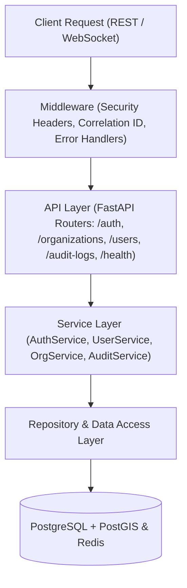

# RESQ AGENT: System Architecture Documentation

## 1. Overview & Operational Paradigm
RESQ AGENT is an AI-powered disaster response and emergency coordination platform designed for multi-tiered disaster authorities (National EOCs, Provincial EOCs, District DEOCs, Palikas, and CERT responders).

### Core Human-in-the-Loop Principles:
1. **AI Never Autonomously Dispatches Resources**: Emergency operations require consequential human judgment.
2. **AI Generates Structured Response Recommendations**: Tool-sandboxed LLMs analyze incidents, assess spatial proximity, and evaluate risks.
3. **Authorized Human Sign-off**: Every action, deployment, and status change requires authorized officer approval.
4. **Tamper-Evident Auditability**: Every critical event produces an HMAC-SHA256 signature to guarantee non-repudiation.
5. **Separation of Demo & Production Data**: Zero mock statistics or fake casualties are introduced into production schemas.

---

## 2. Monorepo Organization

```text
resq-agent/
├── frontend/             # React 18 + Vite responsive command center shell
├── backend/              # Python FastAPI service layer with SQLAlchemy & Alembic
├── infrastructure/       # Docker, PostGIS, and Redis deployment manifests
├── docs/                 # System architecture, security, API, and deployment documentation
├── scripts/              # Development setup and automation scripts
├── tests/                # System-level smoke and integration tests
├── .github/              # GitHub Actions CI/CD pipelines
├── .env.example          # Environment variables specification
├── docker-compose.yml    # Development multi-container orchestration
├── README.md             # Project overview and quickstart
└── LICENSE               # Apache 2.0 License
```

---

## 3. Backend Service Architecture

The backend follows a layered, decoupled service architecture:



---

## 4. Administrative Hierarchy (Nepal Context)

The administrative structure is modeled on Nepal's federal constitution:
- **Level 1 (FEDERAL)**: National Emergency Operation Centre (NEOC) under MoHA / NDRRMA.
- **Level 2 (PROVINCIAL)**: 7 Provincial Emergency Operation Centers (PEOC).
- **Level 3 (DISTRICT)**: 77 District Emergency Operation Centers (DEOC).
- **Level 4 (MUNICIPALITY)**: Metropolitan, Sub-Metropolitan, Municipality, and Rural Municipality (Palika) Disaster Management Units.
- **Level 5 (WARD)**: Local Ward Offices and Community Emergency Response Teams (CERT).

---

## 5. Security & Authentication Architecture
- Dual-token lifecycle: 30-minute Access Token (`JWT_SECRET`) and 7-day Refresh Token (`JWT_REFRESH_SECRET`).
- Token rotation on every refresh request, preventing replay attacks.
- Instant token revocation table (`revoked_tokens`) enabling deterministic session termination upon logout.
- Strict input validation via Pydantic v2 schemas and sanitized error responses.
